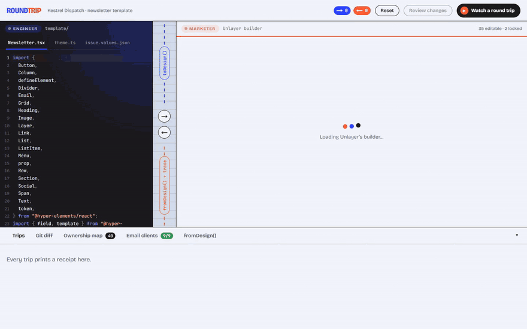
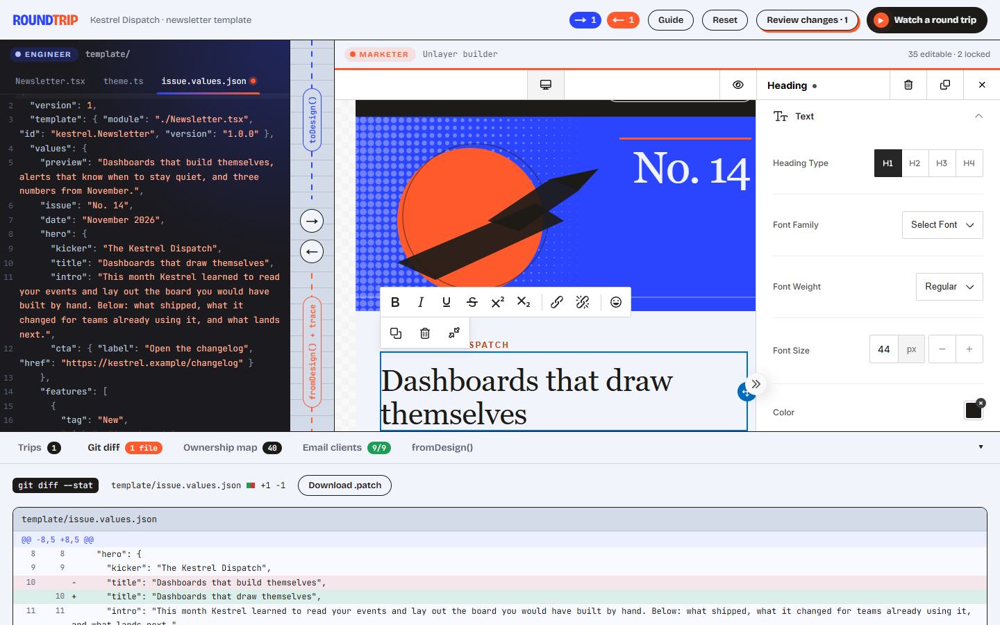
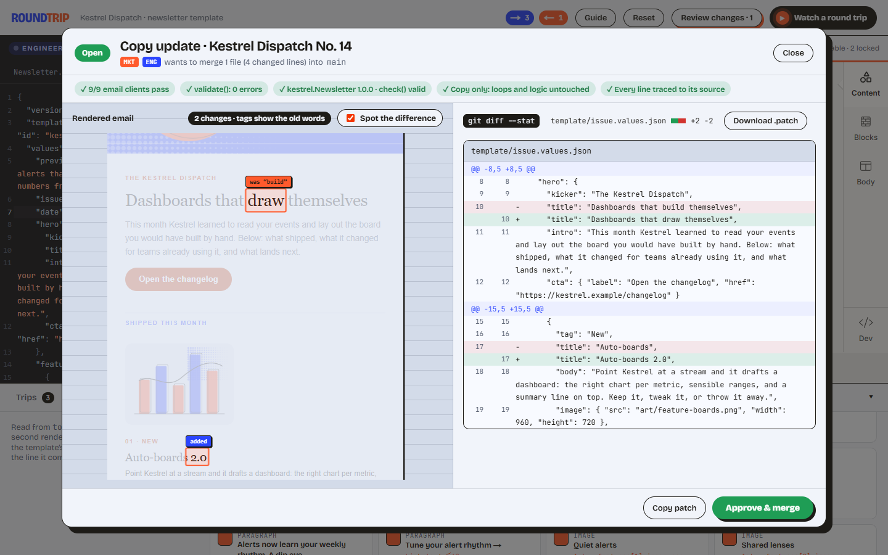
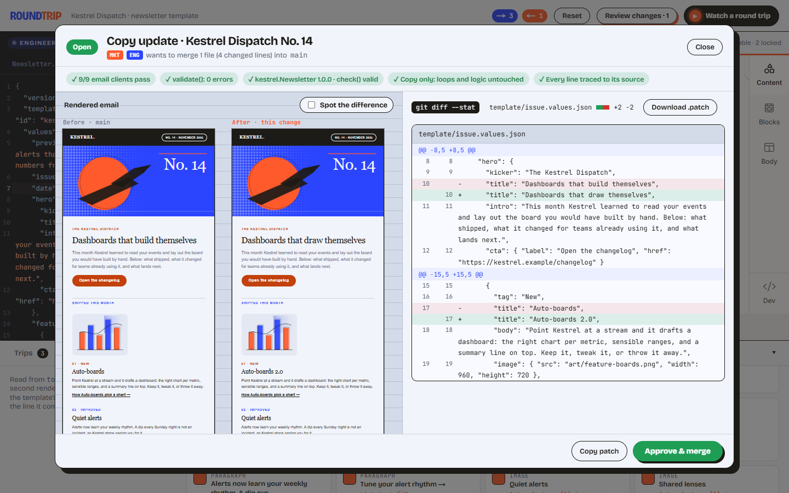
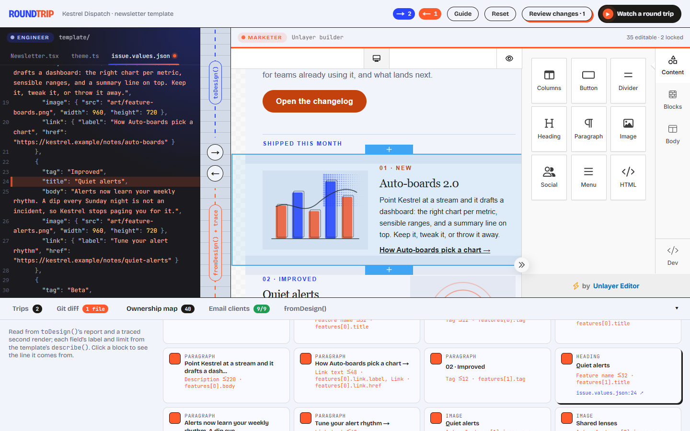
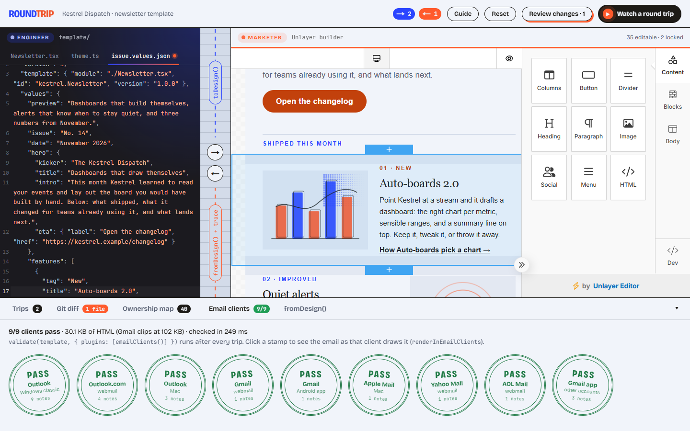
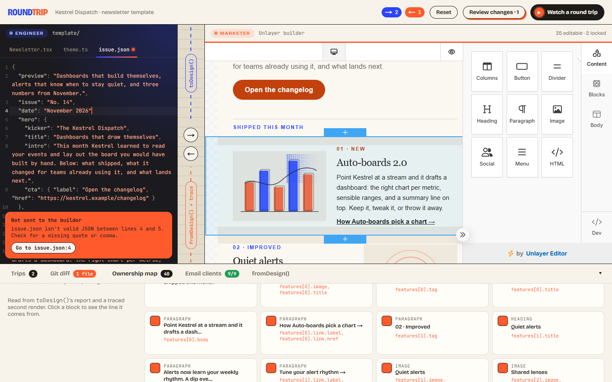
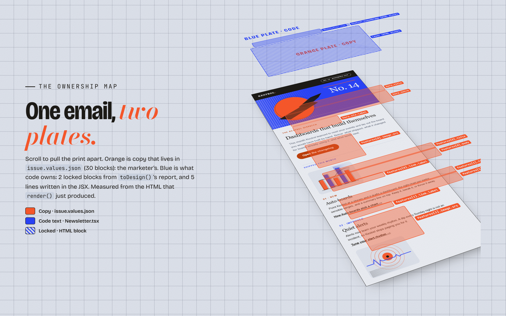

<p align="center">
  
</p>

<p align="center">
  <a href="../../actions/workflows/pages.yml"></a>
  
  
  
  
</p>

<h3 align="center">One email template. Two editors. Zero copy-pasting.</h3>

<p align="center">
  The engineer keeps the newsletter in <b>React</b>. The marketer edits it in <b>Unlayer's drag-and-drop builder</b>.<br/>
  Every builder edit comes back as a <b>one-line git diff</b> on the exact source line it came from,<br/>
  every code edit flows back into the builder, and nine email clients are re-checked after every trip.
</p>

<p align="center">
  <a href="https://franksignorini.github.io/hyper-elements-round-trip/"><b>▶ Open the live demo</b></a> ·
  <a href="https://franksignorini.github.io/hyper-elements-round-trip/studio/">Open the studio</a> ·
  <a href="#run-it">Run it locally</a> ·
  <a href="#how-it-works">How it works</a> ·
  <a href="template/Newsletter.tsx">See the template</a>
</p>

<p align="center">
  
</p>

---

## The problem

Every email team keeps two copies of the truth. Engineers keep the template in code, with its loops and data. Marketers rebuild it in a builder, because that's where they can see it. By Friday the two disagree, and someone copies changes across by hand.

Hyper Elements already ships both halves of a fix: `toDesign()` turns a template into an Unlayer design, and `fromDesign()` turns a design back into JSX. But `fromDesign()` can't know where each word came from. It hands back the design flat, with loops unrolled and data baked in. **Round Trip closes that gap.**

## A round trip in three panels

<table>
  <tr>
    <td width="33%" valign="top">
      
      <p><b>1 · The marketer edits.</b><br/>One word of the headline, in Unlayer's builder, the way they always work.</p>
    </td>
    <td width="33%" valign="top">
      
      <p><b>2 · Code gets one line.</b><br/>The word is traced to <code>issue.json</code> line 7 and patched in place. The loops in <code>Newsletter.tsx</code> are untouched.</p>
    </td>
    <td width="33%" valign="top">
      
      <p><b>3 · Ship it like code.</b><br/>A change request with the diff, the client checks, and the rendered email before and after.</p>
    </td>
  </tr>
</table>

## What you can do with it

<table>
  <tr>
    <td width="50%" valign="top">
      <h4>⇄ Edit on either side</h4>
      Change copy in the builder and <code>issue.json</code> changes by one line. Change <code>issue.json</code> or the JSX in the studio, or in your own editor with <b>Sync with disk</b>, and the builder reloads. Text written in the JSX itself (<i>"On the runway"</i>) is patched in <code>Newsletter.tsx</code>.
    </td>
    <td width="50%" valign="top">
      
    </td>
  </tr>
  <tr>
    <td valign="top">
      
    </td>
    <td valign="top">
      <h4>✓ Review the marketer's edits like a pull request</h4>
      <b>Review changes</b> opens a change request: who edited what, the git diff, checks that are computed and not decorative, and both renders side by side. <b>Spot the difference</b> diffs what the reader sees word by word and marks each change on the new render. A longer headline reflows everything below it, and only the headline lights up. <b>Approve &amp; merge</b> moves <code>main</code> forward.
    </td>
  </tr>
  <tr>
    <td valign="top">
      <h4>⌖ See who owns every block</h4>
      The <b>Ownership map</b> sorts all 40 blocks into copy (from <code>issue.json</code>), code text (in the JSX), locked (a <code>Layer</code> and a custom <code>defineElement()</code> stamp the builder can't edit) and fixed. <b>Click a block</b> and the code panel jumps to the line it comes from.
    </td>
    <td valign="top">
      
    </td>
  </tr>
  <tr>
    <td valign="top">
      
    </td>
    <td valign="top">
      <h4>✉ Nine clients, every trip</h4>
      After each trip the email is rendered and checked with <code>validate()</code> and the <code>emailClients()</code> plugin. Click a stamp to see the email as that client draws it, from classic Outlook on Windows to the Gmail app (<code>renderInEmailClients()</code>).
    </td>
  </tr>
  <tr>
    <td valign="top">
      <h4>⚑ Nothing lands silently</h4>
      An edit that can't land in source is <b>held back with a reason</b>, never written with a wrong value. That covers the <code>01</code> that code numbers, a deleted block, or a locked stamp. One click puts the builder back. A broken edit in code names its file and line, and the builder keeps the last good design.
    </td>
    <td valign="top">
      
    </td>
  </tr>
  <tr>
    <td valign="top">
      
    </td>
    <td valign="top">
      <h4>◐ A landing page printed in two inks</h4>
      A riso-print site: blue for the engineer, orange for the marketer. A live proof loop above the fold, a pinned five-step walkthrough, and a scroll-driven <b>3D plate separation</b> of the real rendered email. Positions are measured from <code>render()</code>'s HTML, not drawn by hand.
    </td>
  </tr>
</table>

Press **▶ Watch a round trip** in the studio for a 30-second guided run through the real pipeline, with captions.

## How it works

```
 Newsletter.tsx + issue.json ──toDesign()──▶ Unlayer builder
          ▲                                        │
          │       one-line patch                   │ design:updated
          └──── trace ◀── fromDesign() ◀───────────┘
                    │
                    └─▶ render() → validate() + emailClients() → 9 client stamps
```

1. **Push.** The template compiles in the browser (Sucrase), and `toDesign()` produces the builder design and a report. The report marks what the builder can't edit. Here that's the `Layer` cover and a custom `defineElement()` stamp, which become **locked zones on purpose**.
2. **Trace.** Round Trip renders the template a second time, with every string in `issue.json` swapped for a numbered token. `toDesign()` is deterministic, so block ids line up with the real design. Each field becomes a pattern like `"01 · ⟦tag⟧"` that maps text back to its data path.
3. **Pull.** When the builder fires `design:updated`, each changed block is matched to its pattern:
   - **Copy** (words from `issue.json`): the new value is patched into the JSON text in place, so the diff is exactly one line.
   - **Code text** (words written in the JSX): the literal is patched in `Newsletter.tsx`.
   - **Computed text** (like the `01` that code numbers): held back with a note for the engineer.
   - **Structure** (added, removed or moved blocks): reported, with the raw `fromDesign()` JSX as ground truth.
4. **Check.** The patched template re-renders, and `validate()` with `emailClients()` runs alongside `renderInEmailClients()`.

<details>
<summary><b>How Hyper Elements is used</b> (nine APIs)</summary>

| API | Package | Where | What it does here |
|---|---|---|---|
| `toDesign()` | `@hyper-elements/react/builder` | `src/lib/rt/engine.ts` | JSX → Unlayer design. Run twice per push: once for real, once traced. Its report drives the locked zones. |
| `fromDesign()` | `@hyper-elements/react/builder` | `src/lib/rt/engine.ts` | The builder's design as JSX, shown raw in the studio as ground truth. |
| `render()` | `@hyper-elements/react` | `src/lib/rt/checks.ts`, `src/lib/landing-data.ts` | Email HTML and text after every trip, the change request's before/after, and the landing page's live specimen. |
| `validate()` + `emailClients()` | `@hyper-elements/react`, `@hyper-elements/email-clients` | `src/app/api/clients/route.ts`, `scripts/roundtrip.tsx` | Template checks per client (Outlook, Gmail, Apple Mail, Yahoo, AOL, more). |
| `renderInEmailClients()` | `@hyper-elements/email-clients` | `src/app/api/clients/route.ts` | Nine client previews, drawn locally, behind each stamp. |
| `defineTheme()` | `@hyper-elements/react` | `template/theme.ts` | The Kestrel brand: colors, type scale, button and kicker styles. |
| `defineElement()` | `@hyper-elements/react` | `template/Newsletter.tsx` | `IssueStamp`, a custom element and a deliberate locked zone. |
| `Canvas` + `renderImage()` | `@hyper-elements/react/image` | `scripts/art.tsx` | Every illustration in the newsletter is drawn by Hyper Elements. There is no stock art. |
| `hyper-elements check` | `@hyper-elements/cli` | `npm run check`, CI | The same checks from the shell, on every push. |

Elements used in the template: `Email`, `Section`, `Row`, `Column`, `Grid`, `Layer`, `Heading`, `Text`, `Span`, `Link`, `Button`, `Image`, `Divider`, `List`, `ListItem`, `Social`, `Menu`, plus `token()`, theme `styles`, scoped `tokens` and phone styles.

`npm run check` passes with **0 errors and 0 warnings**, and the checks earned their keep:

- The emulator's Gmail-app preview showed the masthead wrapping to "KESTRE / L." on a 380px phone. The fix is the `mobile` styles on the wordmark and stamp column.
- The CLI's lint flagged the bright brand orange at under 4.5:1 for text and buttons, a missing `lang`, and an h1→h3 skip. Text now uses a burnt orange (`#c2410c`); the bright orange stays in the art and on the dark masthead.

</details>

## Run it

Requires Node.js 20 or later.

```bash
npm install
npm run dev
```

Open <http://localhost:3000> for the landing page and <http://localhost:3000/studio> for the studio. The Unlayer builder loads from `editor.unlayer.com` and **needs no project ID**.

Then try it:

1. Click the headline *"Dashboards that build themselves"* in the builder and change a word. `issue.json` changes on the left, and **Git diff** shows one line.
2. Edit a feature title in `issue.json`. The builder reloads with it.
3. Change the `01` in *"01 · New"* in the builder. It's computed in code, so it's held back with a note.
4. Open **Email clients** and click a stamp.
5. Press **Review changes**, turn on **Spot the difference**, then **Approve & merge**.

**Sync with disk** (dev only) writes every trip to `template/` and picks up saves from your own editor, so `git diff` in your terminal shows the same one-line change.

> On `http://localhost` the builder (served over https) can't show images from your machine. The email itself is fine. Set `NEXT_PUBLIC_ASSET_BASE` to any https copy of `public/` to see the art inside the builder locally. The deployed site has no such issue.

<details>
<summary><b>Headless: the round trip from the shell</b></summary>

```bash
npm run push                            # template/ → out/design.json, plus the locked-zone report and client checks
npm run pull -- edited.design.json      # an edited design → patches template/, prints the receipt, re-checks clients
npm run check                           # hyper-elements check on the template
npm run art                             # redraw the illustrations with Canvas + renderImage()
```

`npm run pull -- out/design.json` reverses a push, so a design exported from any Unlayer integration can round-trip.

</details>

<details>
<summary><b>Deploy</b>: GitHub Pages, or any Node host</summary>

**GitHub Pages (this repo).** `.github/workflows/pages.yml` runs typecheck, lint, `hyper-elements check` and the full build on every push and pull request. On `main` it then publishes a static export to Pages. One-time setup: *Settings → Pages → Source: GitHub Actions*.

Pages serves static files only, so the live demo runs `render()` and `validate()` in your browser. The per-client emulator (`emailClients()`, `renderInEmailClients()`) needs Node, and the studio says so where its stamps would be. To get everything, run it locally or on a Node host:

```bash
npm run build && npm start
```

There, `/` and `/studio` are static, `/api/clients` runs the emulator on Node (it reads its measured fonts from disk), and `/api/template` (disk sync) answers 404 outside development.

</details>

<details>
<summary><b>Project layout</b></summary>

```
template/            the template: Newsletter.tsx, issue.json, theme.ts
src/lib/rt/          the round-trip engine
  compile.ts         Sucrase + a tiny require(): template files → component, in the browser
  bind.ts            sentinel render, patterns, path helpers
  design.ts          reads Unlayer designs as blocks and fields (lexical, HTML, buttons, images, menus)
  engine.ts          build() and pull()
  jsonText.ts        format-preserving JSON patch (one-line diffs) and value lookup
  ownership.ts       copy / code text / locked / fixed
  checks.ts          render + validate in the browser, emulator via /api/clients
  spot.ts            "Spot the difference": a word-level diff of two renders
  errors.ts          build errors → file, line and a sentence
src/components/      studio (Builder, CodePanel, DiffView, ClientStamps, ReviewModal) and landing
src/app/api/         clients (emulator) and template (dev-only disk sync)
scripts/             roundtrip.tsx (CLI), art.tsx (Canvas art), capture.mjs (README media), dev.mjs
.github/workflows/   pages.yml: checks on every push, GitHub Pages deploy from main
```

</details>

## Honest limits

- Rich formatting added in the builder (bold, a new link) isn't written back. Words are. The design keeps the formatting, and the receipt tells you.
- Structural edits (new or deleted blocks) aren't merged into the JSX. They're reported, and the `fromDesign()` tab shows them as code to copy.
- Template checks with the full plugin run on the server only when the studio's JSX matches the committed template, because the server never runs code it is sent. HTML-level client checks always run.
- The live demo on GitHub Pages has no Node server, so the client emulator runs only locally or on a Node host.

## License

MIT. Built for the [Hyper Elements Template Challenge](https://github.com/hyper-elements/hyper-elements/discussions/categories/challenge-submissions) with [Hyper Elements](https://hyperelements.dev) and [Unlayer](https://unlayer.com).
