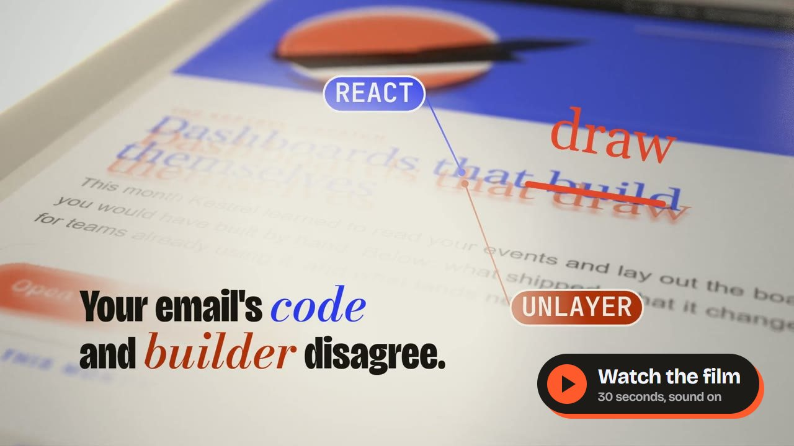
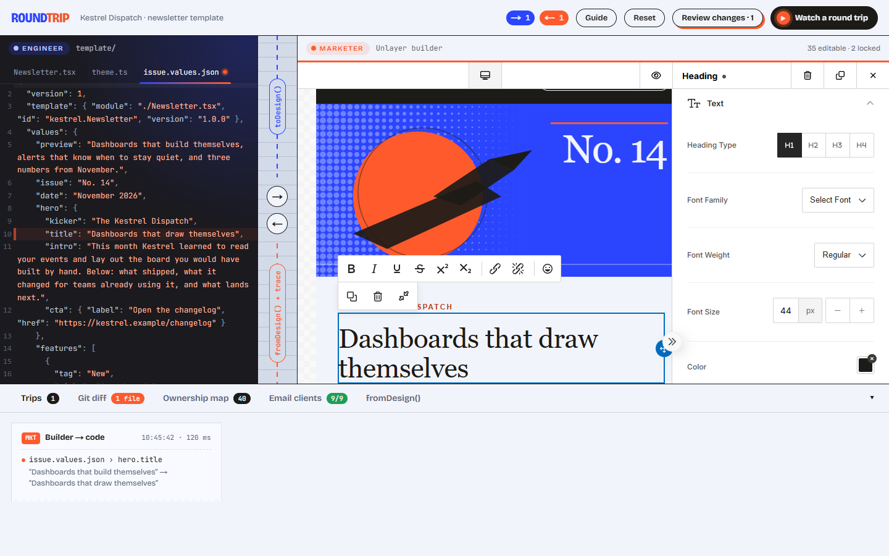
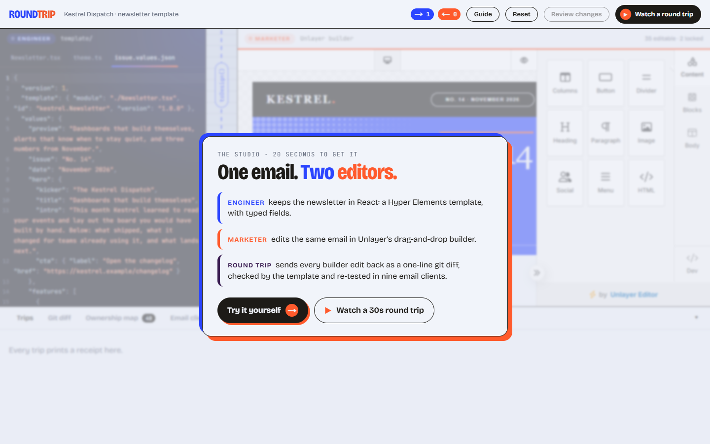
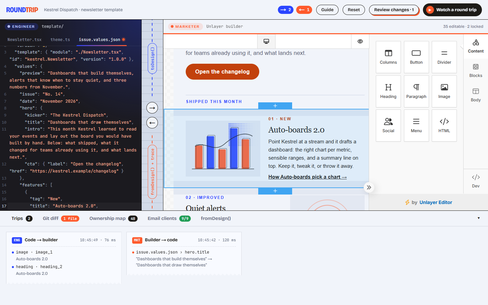
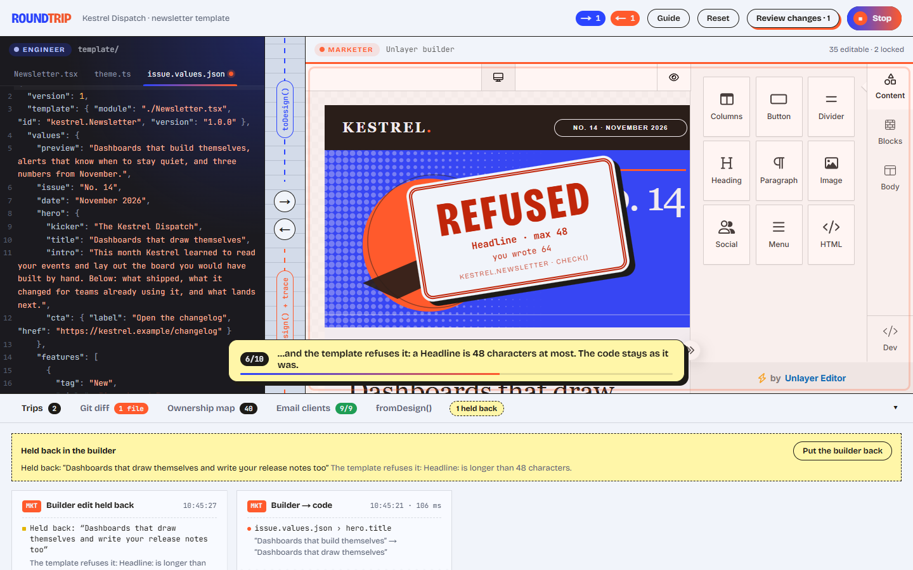

<p align="center">
  
</p>

<p align="center">
  <a href="../../actions/workflows/pages.yml"></a>
  
  
  
  
</p>

<h3 align="center">One email template. Two editors. Zero copy-pasting.</h3>

<p align="center">
  The engineer keeps the newsletter in <b>React</b>. The marketer edits it in <b>Unlayer's drag-and-drop builder</b>.<br/>
  Every builder edit comes back as a <b>one-line git diff</b> on the exact source line it came from,<br/>
  every code edit flows back into the builder, and nine email clients are re-checked after every trip.
</p>

<p align="center">
  <a href="https://franksignorini.github.io/hyper-elements-round-trip/"><b>▶ Open the live demo</b></a> ·
  <a href="https://franksignorini.github.io/hyper-elements-round-trip/studio/">Open the studio</a> ·
  <a href="#run-it">Run it locally</a> ·
  <a href="#how-it-works">How it works</a> ·
  <a href="template/Newsletter.tsx">See the template</a>
</p>

<p align="center">
  <a href="https://franksignorini.github.io/hyper-elements-round-trip/#film"></a>
  <br/><sub><a href="https://franksignorini.github.io/hyper-elements-round-trip/#film">▶ Watch the 30-second film</a> (sound on) · or <a href="public/film/round-trip.mp4">download the MP4</a></sub>
</p>

<p align="center">
  
</p>

---

## The problem

Every email team keeps two copies of the truth. Engineers keep the template in code, with its loops and data. Marketers rebuild it in a builder, because that's where they can see it. By Friday the two disagree, and someone copies changes across by hand.

Hyper Elements already ships both halves of a fix: `toDesign()` turns a template into an Unlayer design, and `fromDesign()` turns a design back into JSX. But `fromDesign()` can't know where each word came from. It hands back the design flat, with loops unrolled and data baked in. **Round Trip closes that gap.**

## A round trip in three panels

<table>
  <tr>
    <td width="33%" valign="top">
      
      <p><b>1 · The marketer edits.</b><br/>One word of the headline, in Unlayer's builder, the way they always work.</p>
    </td>
    <td width="33%" valign="top">
      
      <p><b>2 · Code gets one line.</b><br/>The word is traced to the <code>hero.title</code> field, checked by the template, and patched in place on <code>issue.values.json</code> line 10. The loops in <code>Newsletter.tsx</code> are untouched.</p>
    </td>
    <td width="33%" valign="top">
      
      <p><b>3 · Ship it like code.</b><br/>A change request with the diff, the client checks, and the rendered email before and after.</p>
    </td>
  </tr>
</table>

## What you can do with it

<table>
  <tr>
    <td width="50%" valign="top">
      
    </td>
    <td width="50%" valign="top">
      <h4>◎ Get it in twenty seconds</h4>
      A first visit opens on an intro that plays while Unlayer's builder loads: three lines, each lighting the panel it names. Then a four-step tour that ticks itself off as you do the round trip yourself, and every edit sends the word itself flying to the line it landed on.
    </td>
  </tr>
  <tr>
    <td width="50%" valign="top">
      <h4>⇄ Edit on either side</h4>
      Change copy in the builder and <code>issue.values.json</code> changes by one line. Change the values or the JSX in the studio, or in your own editor with <b>Sync with disk</b>, and the builder reloads. Text written in the JSX itself (<i>"On the runway"</i>) is patched in <code>Newsletter.tsx</code>.
    </td>
    <td width="50%" valign="top">
      
    </td>
  </tr>
  <tr>
    <td valign="top">
      
    </td>
    <td valign="top">
      <h4>✓ Review the marketer's edits like a pull request</h4>
      <b>Review changes</b> opens a change request: who edited what, the git diff, checks that are computed and not decorative, and both renders side by side. <b>Spot the difference</b> diffs what the reader sees word by word and marks each change on the new render. A longer headline reflows everything below it, and only the headline lights up. <b>Approve &amp; merge</b> moves <code>main</code> forward.
    </td>
  </tr>
  <tr>
    <td valign="top">
      <h4>⌖ See who owns every block</h4>
      The <b>Ownership map</b> sorts all 40 blocks into copy (the template's fields, each with its label and limit from <code>describe()</code>, like <i>Headline ≤48</i>), code text (in the JSX), locked (a <code>Layer</code> and a custom <code>defineElement()</code> stamp the builder can't edit) and fixed. <b>Click a block</b> and the code panel jumps to the line it comes from.
    </td>
    <td valign="top">
      
    </td>
  </tr>
  <tr>
    <td valign="top">
      
    </td>
    <td valign="top">
      <h4>✉ Nine clients, every trip</h4>
      After each trip the email is rendered and checked with <code>validate()</code> and the <code>emailClients()</code> plugin. Click a stamp to see the email as that client draws it, from classic Outlook on Windows to the Gmail app (<code>renderInEmailClients()</code>).
    </td>
  </tr>
  <tr>
    <td valign="top">
      <h4>⚑ Nothing lands silently</h4>
      An edit that can't land in source is <b>held back with a reason</b>, never written with a wrong value. That covers the <code>01</code> that code numbers, a deleted block, a locked stamp, and <b>anything the template refuses</b>: a 70-character headline in the builder comes back as <i>"The template refuses it: Headline: is longer than 48 characters."</i> One click puts the builder back. A broken edit in code names its file and line, and the builder keeps the last good design.
    </td>
    <td valign="top">
      
    </td>
  </tr>
  <tr>
    <td valign="top">
      
    </td>
    <td valign="top">
      <h4>◐ A landing page printed in two inks</h4>
      A riso-print site: blue for the engineer, orange for the marketer. A live proof loop above the fold, a pinned five-step walkthrough, and a scroll-driven <b>3D plate separation</b> of the real rendered email. Positions are measured from <code>render()</code>'s HTML, not drawn by hand.
    </td>
  </tr>
</table>

**First time in the studio?** A 20-second intro plays while Unlayer's builder loads, then a four-step tour ticks itself off as you work: change a word (it lands on its line), make the headline too long (the template stamps it **REFUSED**), edit a title in code (the builder follows), open the change request. Every trip shows the edited word itself flying to the line it landed on. Or press **▶ Watch a round trip** for a 30-second guided run through the real pipeline, with captions. On a phone, the studio shows the film instead.

## How it works

```
 Newsletter.tsx (template()) + issue.values.json ──check() → design() → toDesign()──▶ Unlayer builder
          ▲                                                                            │
          │       one-line patch, if the template's check() accepts it                 │ design:updated
          └──── trace ◀── fromDesign() ◀───────────────────────────────────────────────┘
                    │
                    └─▶ render() → validate() + emailClients() → 9 client stamps
```

The template is a Hyper Elements `template()`: typed, labelled fields with limits and guidance (`hero.title` is a *Headline* of at most 48 characters), and a `render` that owns every loop and layout decision. Its copy lives in `issue.values.json`, a standard Hyper Elements **values file**, so the official CLI checks it as it stands: `hyper-elements check template/issue.values.json`.

1. **Push.** The template compiles in the browser (Sucrase). `readValuesFile()` reads the values against it, `check()` validates them, `design()` builds the email, and `toDesign()` produces the builder design and a report. The report marks what the builder can't edit. Here that's the `Layer` cover and a custom `defineElement()` stamp, which become **locked zones on purpose**.
2. **Trace.** Round Trip builds the design a second time, with every value swapped for a numbered token. `toDesign()` is deterministic, so block ids line up with the real design. Each field becomes a pattern like `"01 · ⟦tag⟧"` that maps text back to its field path. (A node's `field=` binding isn't written into the Unlayer design, so the trace is what carries provenance through the builder.)
3. **Pull.** When the builder fires `design:updated`, each changed block is matched to its pattern:
   - **Copy** (a template field): the new value is checked by the template's `check()`. If it passes, it's patched into the values file in place, so the diff is exactly one line. If not, it's held back with the template's own message.
   - **Code text** (words written in the JSX): the literal is patched in `Newsletter.tsx`.
   - **Computed text** (like the `01` that code numbers): held back with a note for the engineer.
   - **Structure** (added, removed or moved blocks): reported, with the raw `fromDesign()` JSX as ground truth.
4. **Check.** The patched template re-renders, and `validate()` with `emailClients()` runs alongside `renderInEmailClients()`.

<details>
<summary><b>How Hyper Elements is used</b> (twelve APIs)</summary>

| API | Package | Where | What it does here |
|---|---|---|---|
| `template()` + `field.image()` + `prop.*` | `@hyper-elements/react/template` | `template/Newsletter.tsx` | The newsletter as a template: typed, labelled fields with limits and guidance; everything else is fixed. |
| `readValuesFile()` + `check()` + `design()` | `@hyper-elements/react/template` | `src/lib/rt/engine.ts` | Reads `issue.values.json`, checks it, builds the email. `check()` runs again on every builder edit and refuses what the template refuses. |
| `describe()` | `@hyper-elements/react/template` | `src/lib/rt/ownership.ts` | Each field's label, limit and guidance, shown on its block in the ownership map. |
| `toDesign()` | `@hyper-elements/react/builder` | `src/lib/rt/engine.ts` | JSX → Unlayer design. Run twice per push: once for real, once traced. Its report drives the locked zones. |
| `fromDesign()` | `@hyper-elements/react/builder` | `src/lib/rt/engine.ts` | The builder's design as JSX, shown raw in the studio as ground truth. |
| `render()` | `@hyper-elements/react` | `src/lib/rt/checks.ts`, `src/lib/landing-data.ts` | Email HTML and text after every trip, the change request's before/after, and the landing page's live specimen. |
| `validate()` + `emailClients()` | `@hyper-elements/react`, `@hyper-elements/email-clients` | `src/app/api/clients/route.ts`, `scripts/roundtrip.tsx` | Template checks per client (Outlook, Gmail, Apple Mail, Yahoo, AOL, more). |
| `renderInEmailClients()` | `@hyper-elements/email-clients` | `src/app/api/clients/route.ts` | Nine client previews, drawn locally, behind each stamp. |
| `defineTheme()` | `@hyper-elements/react` | `template/theme.ts` | The Kestrel brand: colors, type scale, button and kicker styles. |
| `defineElement()` | `@hyper-elements/react` | `template/Newsletter.tsx` | `IssueStamp`, a custom element and a deliberate locked zone. |
| `Canvas` + `renderImage()` | `@hyper-elements/react/image` | `scripts/art.tsx` | Every illustration in the newsletter is drawn by Hyper Elements. There is no stock art. |
| `hyper-elements check` | `@hyper-elements/cli` | `npm run check`, CI | The template module (with its example) and the values file, checked from the shell on every push. `package.json` lists `template/**` as trusted templates. |

Elements used in the template: `Email`, `Section`, `Row`, `Column`, `Grid`, `Layer`, `Heading`, `Text`, `Span`, `Link`, `Button`, `Image`, `Divider`, `List`, `ListItem`, `Social`, `Menu`, plus `token()`, theme `styles`, scoped `tokens` and phone styles.

`npm run check` passes with **0 errors and 0 warnings**, and the checks earned their keep:

- The emulator's Gmail-app preview showed the masthead wrapping to "KESTRE / L." on a 380px phone. The fix is the `mobile` styles on the wordmark and stamp column.
- The CLI's lint flagged the bright brand orange at under 4.5:1 for text and buttons, a missing `lang`, and an h1→h3 skip. Text now uses a burnt orange (`#c2410c`); the bright orange stays in the art and on the dark masthead.

</details>

## Run it

Requires Node.js 20 or later.

```bash
npm install
npm run dev
```

Open <http://localhost:3000> for the landing page and <http://localhost:3000/studio> for the studio. The Unlayer builder loads from `editor.unlayer.com` and **needs no project ID**.

Then try it:

1. Click the headline *"Dashboards that build themselves"* in the builder and change a word. `issue.values.json` changes on the left, and **Git diff** shows one line.
2. Now make the headline longer than 48 characters. The template refuses it, and the edit is held back with its message.
3. Edit a feature title in `issue.values.json`. The builder reloads with it.
4. Change the `01` in *"01 · New"* in the builder. It's computed in code, so it's held back with a note.
5. Open **Email clients** and click a stamp.
6. Press **Review changes**, turn on **Spot the difference**, then **Approve & merge**.

**Sync with disk** (dev only) writes every trip to `template/` and picks up saves from your own editor, so `git diff` in your terminal shows the same one-line change.

The art is served from the deployed site (`ASSETS` in `template/theme.ts`), so the builder shows it on `localhost` too.

## Use it on your own template

Round Trip isn't tied to the newsletter. Any Hyper Elements `template()` with a values file works, and [`examples/welcome/`](examples/welcome) is a second, unrelated one to copy from:

1. **Write your template** with `template()`: the copy a marketer should own as typed `fields`, everything else in `render`. Loops, conditions and custom elements are fine.
2. **Keep its copy in a values file** (`hyper-elements design new` writes one). It names its template, so that's the only path Round Trip needs:
   ```json
   { "version": 1, "template": { "module": "./Welcome.tsx", "id": "examples.Welcome", "version": "1.0.0" }, "values": { … } }
   ```
3. **Push it to the builder:** `npm run push -- examples/welcome/welcome.values.json` writes `out/welcome.design.json`. Load it in any Unlayer editor (`editor.loadDesign()`), and let your marketer edit it.
4. **Pull the edits back:** export the design (`editor.saveDesign()`) and run `npm run pull -- edited.design.json examples/welcome/welcome.values.json`. Each edit becomes a one-line patch to the values file, or to a literal in the template. Anything your template's `check()` refuses is held back with its reason, and the email clients are re-checked.

What it needs from a template: copy that arrives as field values, which is what `template()` asks for anyway. What stays code-owned: anything the builder has no tool for (a `Layer`, your own `defineElement()`), which `toDesign()`'s report names and Round Trip locks.

<details>
<summary><b>Headless: every command</b></summary>

```bash
npm run push [-- my.values.json]                        # template → out/<name>.design.json, the locked-zone report, client checks
npm run pull -- edited.design.json [my.values.json]     # an edited design → patches, checked by the template, then clients
npm run check                                           # hyper-elements check: both templates and their values files
npm run selftest                                        # the round trip's invariants: determinism, ids, one-line diffs, guardrails
npm run bake:clients                                    # the email-client verdicts and previews the static site shows
npm run art                                             # redraw the illustrations with Canvas + renderImage()
```

Without a values file, both commands use the Kestrel newsletter. `npm run pull -- out/design.json` reverses a push, so a design exported from any Unlayer integration can round-trip.

</details>

<details>
<summary><b>Deploy</b>: GitHub Pages, or any Node host</summary>

**GitHub Pages (this repo).** `.github/workflows/pages.yml` runs typecheck, lint, `hyper-elements check` and the full build on every push and pull request. On `main` it then publishes a static export to Pages. One-time setup: *Settings → Pages → Source: GitHub Actions*.

Pages serves static files only, so the live demo runs `render()` and `validate()` in your browser, and the per-client emulator (`emailClients()`, `renderInEmailClients()`), which needs Node, runs once at build time on the committed template (`npm run bake:clients`): the studio's nine stamps and previews are real, and once you edit the template it says they're for the committed one. To emulate every edit, run it locally or on a Node host:

```bash
npm run build && npm start
```

There, `/` and `/studio` are static, `/api/clients` runs the emulator on Node (it reads its measured fonts from disk), and `/api/template` (disk sync) answers 404 outside development.

</details>

<details>
<summary><b>Project layout</b></summary>

```
template/            the template: Newsletter.tsx (template()), issue.values.json (its values file), theme.ts
examples/welcome/    a second template, to show any template() with a values file round-trips
public/film/         the 30-second film and its poster
src/lib/rt/          the round-trip engine
  compile.ts         Sucrase + a tiny require(): template files → a live template(), in the browser
  bind.ts            sentinel render, patterns, path helpers
  design.ts          reads Unlayer designs as blocks and fields (lexical, HTML, buttons, images, menus)
  engine.ts          build() and pull()
  jsonText.ts        format-preserving JSON patch (one-line diffs) and value lookup
  ownership.ts       copy / code text / locked / fixed, with field labels from describe()
  checks.ts          render + validate in the browser, emulator via /api/clients (or the build's report on Pages)
  spot.ts            "Spot the difference": a word-level diff of two renders
  errors.ts          build errors → file, line and a sentence
src/components/      studio (Builder, CodePanel, DiffView, ClientStamps, ReviewModal, Guide, PhoneStudio) and landing (Film…)
src/app/api/         clients (emulator) and template (dev-only disk sync)
scripts/             roundtrip.tsx (CLI, any template), selftest.tsx, bake-clients.tsx (static-site client checks),
                     art.tsx (Canvas art), capture.mjs (README media), dev.mjs
.github/workflows/   pages.yml: checks on every push, GitHub Pages deploy from main
```

</details>

## Honest limits

- Rich formatting added in the builder (bold, a new link) isn't written back. Words are. The design keeps the formatting, and the receipt tells you.
- Structural edits (new or deleted blocks) aren't merged into the JSX. They're reported, and the `fromDesign()` tab shows them as code to copy.
- An image swapped in the builder keeps its declared size (`width`, `height`) in the values file, so the template checks it against the old size until someone runs `hyper-elements design set … @path`, which reads the new file's size.
- Template checks with the full plugin run on the server only when the studio's JSX matches the committed template, because the server never runs code it is sent. HTML-level client checks always run.
- The live demo on GitHub Pages has no Node server: its client stamps and previews are the committed template's, checked when the site was built. Your edits there are checked by `validate()` in the browser; the emulator re-checks every trip locally or on a Node host.
- The studio's in-browser editor runs the Kestrel newsletter; other templates round-trip through the CLI.

## License

MIT. Built for the [Hyper Elements Template Challenge](https://github.com/hyper-elements/hyper-elements/discussions/categories/challenge-submissions) with [Hyper Elements](https://hyperelements.dev) and [Unlayer](https://unlayer.com).
